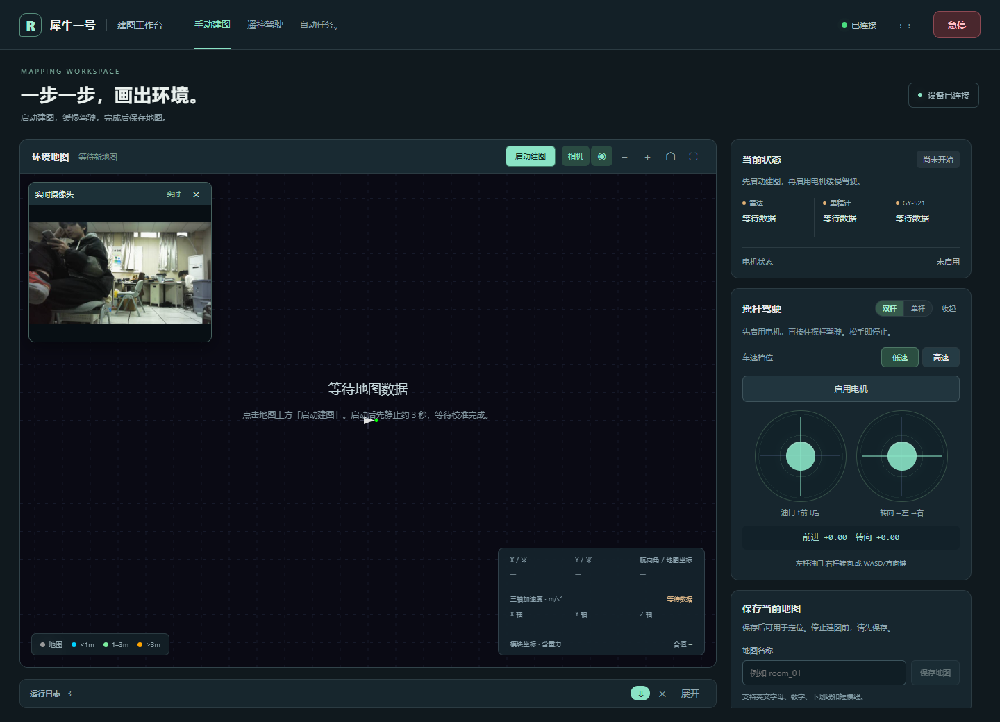
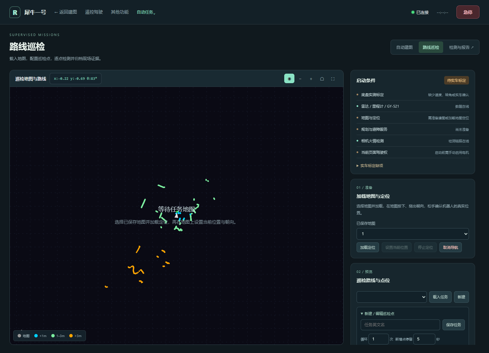
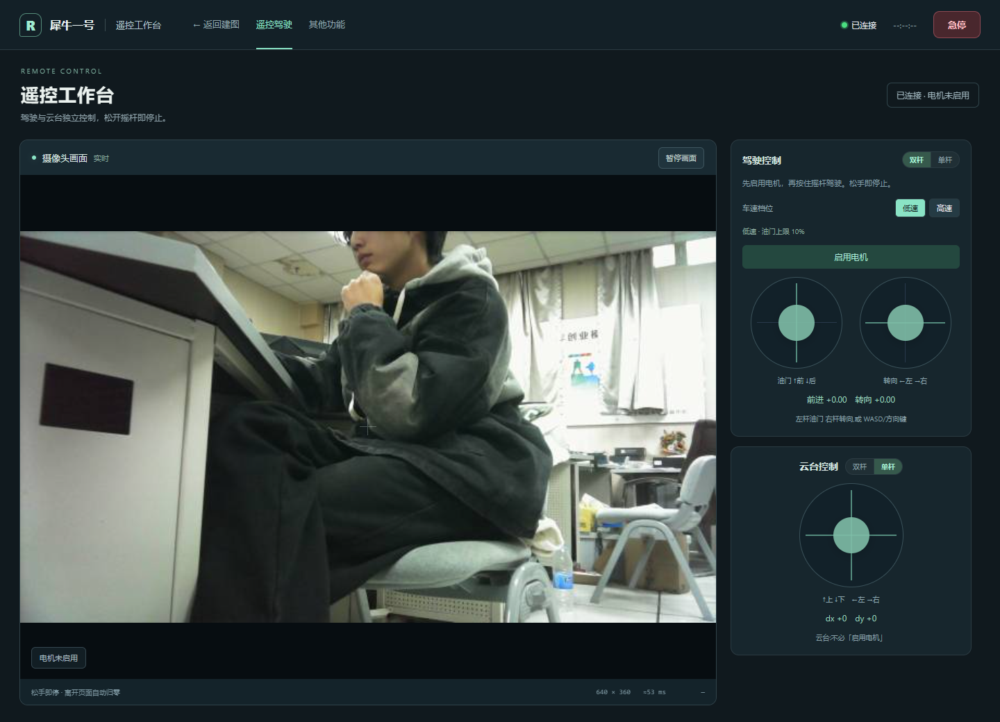
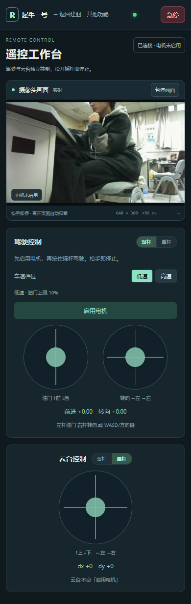
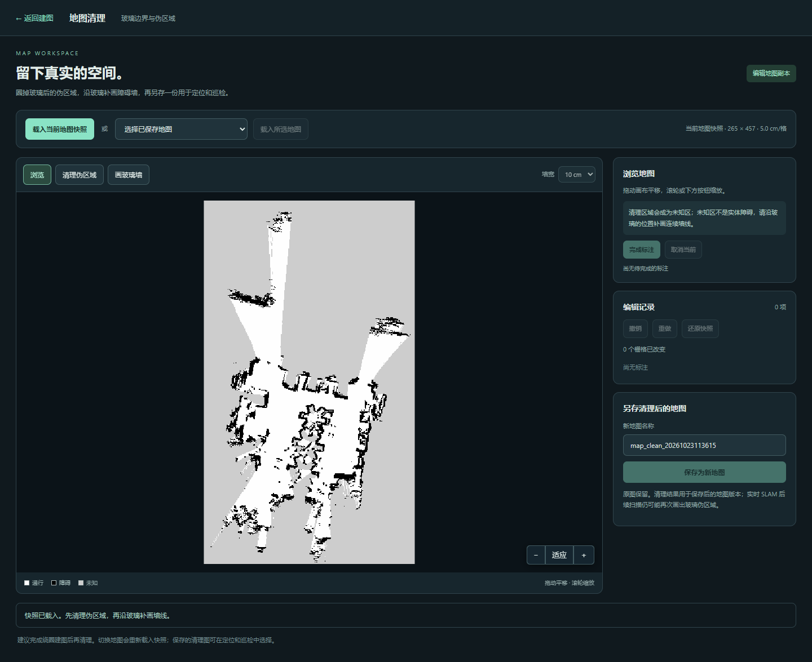
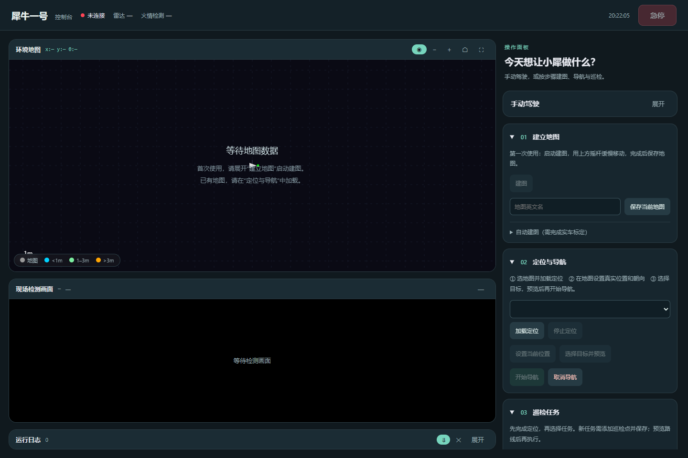
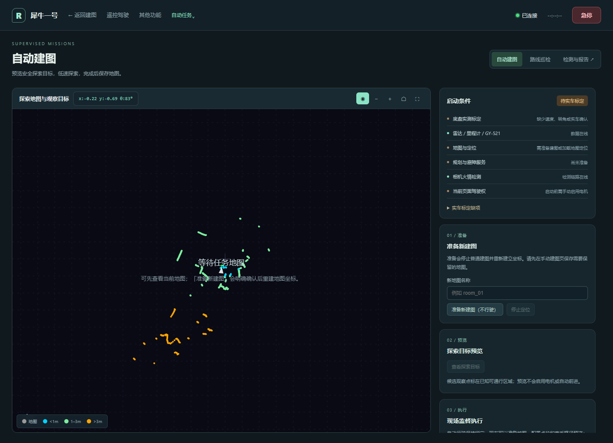

# 技术文档：全域火情隐患智能监测巡检机器人

> 平台：阿加犀 犀牛派 X1（QCS8550）｜系统：Ubuntu 22.04 + AidLux｜框架：ROS 2 Humble

---

## 1. 项目背景与痛点

仓储、机房、实验室等室内场所的火灾隐患巡检，长期依赖人工定时巡查：

| 痛点 | 具体表现 |
|---|---|
| 频次不足 | 人工每班 1~2 次，夜间与周末空档长 |
| 记录不可追溯 | 纸质/口头记录，无法回看现场图像 |
| 早期隐患难发现 | 烟雾、初期明火靠人眼，发现时往往已扩大 |
| 人力成本 | 重复路线、重复动作，人员流动性大 |
| 危险场景 | 起火点附近不宜久留 |

本项目的目标：**让一台低成本轮式机器人替代重复巡检动作**，做到"到点、停稳、拍照、判断、留档"，
并把地图、位置、图像、结论绑定在一起，形成可追溯的巡检记录。

---

## 2. 设计理念

### 2.1 先"稳"再"智能"

巡检机器人的第一风险不是"检测不准"，而是**失控**。因此几条硬约束贯穿设计：

1. 任何运动输出都必须经过 `armed` 门控（只有点了"启用电机"的客户端能驱动）。
2. 链路断开 300ms 内必须停车（deadman），不依赖上层心跳。
3. 导航速度不直接给电机，必须经过**监督试航包络**（限速、限转向、限时长、限距离、净空检查）。
4. 巡检到点后必须通过"停稳确认"才取图，避免运动模糊与位置漂移。

### 2.2 计算与执行解耦

软 PWM（1kHz）是纯 Python 忙等线程，放进 ROS 节点会与 rclpy 抢 GIL，实测控制回调 p99 达 466ms，
表现为"松手后车还在跑"。因此把电机、舵机各自拆成**独立进程**，通过 UDP 与网页通信：

```
网页摇杆 60Hz → slam_viz → UDP 127.0.0.1:5813 → pwm_proc → GPIO
                         → UDP 127.0.0.1:5816 → servo_proc → GPIO
```

拆出后轮询稳定在 199~200Hz，PWM 线程 CPU 从 93~100% 降到 6.7%。

### 2.3 可观测、可证伪

每个子系统都必须有**不依赖人眼**的验证手段：

- 里程计：`/odom` 频率与位姿跳变监控
- 电机：`/tmp/pwm_proc.log` 每 5 秒一行（包率/龄期/duty/dir/servo）
- 云台：状态行报"目标值 vs 已发值"
- 网页：`web_drive_test.js` 在假 DOM 上跑真实内联 JS

---

## 3. 应用场景

| 场景 | 说明 |
|---|---|
| 仓库夜间巡检 | 按预设点位巡查，发现明火/烟雾即报警并留证 |
| 机房/配电间 | 狭窄通道低速通过，定点拍照比对 |
| 实验室/车间 | 班后自动走一圈，生成巡检报告 |
| 教学演示 | 完整链路可作为 ROS 2 教学案例（建图→定位→导航→任务） |

---

## 4. 系统总体架构

```
┌──────────────────────────── 网页端 (Flask + SocketIO :5800) ────────────────────────────┐
│  遥控驾驶  │  实时建图  │  导航选点  │  自动巡检  │  地图管理  │  巡检报告                │
└──────┬─────────────┬─────────────┬──────────────┬──────────────┬────────────────────────┘
       │UDP 5813     │UDP 5816     │UDP 5814      │ROS 话题      │文件系统
       ▼             ▼             ▼              ▼              ▼
  pwm_proc      servo_proc     gimbal_proc    navigation_runtime   data/maps
  (200Hz软PWM)  (50Hz舵机)     (串口云台)      patrol_runner        data/patrols
       │             │             │              │                data/inspections
       ▼             ▼             ▼              ▼
   L298N 双通道   转向舵机      二维云台      Nav2 / AMCL / TF
                                                ▲
  RPLidar A1 ──/scan──┐                         │
  GY-521 ──/imu/data_raw──┴─ laser_imu_odom ──/odom + TF─┴─ slam_toolbox ──/map
```

### 4.1 分层

| 层 | 模块 | 职责 |
|---|---|---|
| 表现层 | `web/` | 页面、SocketIO 事件、驾驶权仲裁 |
| 业务层 | `navigation/`、`inspection/` | 地图存储、Nav2 生命周期、巡检状态机、报告生成 |
| 驱动层 | `motor/`、`gimbal/`、`camera/`、`slam/` | GPIO/UART/相机/雷达与传感器融合 |
| 工具层 | `tools/`、`stage1/`、`stage2/` | 诊断、验收、数据回放 |

---

## 5. 硬件选型

| 部件 | 选型 | 理由 | 约束 |
|---|---|---|---|
| 计算平台 | 犀牛派 X1（QCS8550） | 自带 NPU 可跑本地 VLM；AidLux 提供 ROS 2 与 Python 环境 | 需自行编译 RPLidar、slam_toolbox 工作空间 |
| 激光雷达 | RPLidar A1 | 成本低、ROS 驱动成熟 | 实测 7.7Hz（硬件上限），快速旋转会拖影 |
| 姿态传感器 | GY-521（MPU6050） | I²C、便宜、100Hz 可用 | 需静止标定；模块质量参差，需验证零偏 |
| 底盘 | 阿克曼（后驱+前舵机） | 转向平滑、适合室内 | 转弯半径大（实测约 0.65m），窄处需预留 |
| 电机驱动 | L298N 双通道 | 便宜、逻辑简单 | 有压降、无电流反馈；通道与左右轮交叉 |
| 相机 | USB UVC 640×480 MJPG | 免驱、低延迟 | 单读，只能一个进程持有 |
| 云台 | 串口二维云台 | 可远程调整视角 | 协议无重传，断链需持续发零速帧 |

> 引脚级接线见 `motor/motor_wiring.md`、`gimbal/gimbal_wiring.md`、`slam/gyro_mapping_README.md`。

---

## 6. 软件环境搭建

### 6.1 基础环境

```bash
# ROS 2 Humble 已随 AidLux 提供
source /opt/ros/humble/setup.bash

# 雷达与 SLAM 工作空间
cd ~/lidar_ws && colcon build
source ~/lidar_ws/install/setup.bash
```

### 6.2 Python 依赖

```bash
pip install -r requirements.txt
```

系统包：`python3-gpiod`（GPIO）、`python3-opencv`（图像）。

### 6.3 权限

| 设备 | 要求 |
|---|---|
| `/dev/gpiochip0` | `root:gpio 660`，`aidlux` 在 `gpio` 组；由 `fix-gpio-perms.service` 开机自愈 |
| `/dev/i2c-1` | `root:aidlux 660`；由 `fix-imu-perms.service` 保证 |
| `/dev/ttyUSB0`（雷达） | `dialout` 组 |
| `/dev/ttyHS1`（云台） | `666` |

### 6.4 关键配置

| 文件 | 内容 |
|---|---|
| `motor/motor_params.yaml` | 引脚、`swap_lr`、`flip_*`、`steer_mode`、deadman |
| `gimbal/gimbal_params.yaml` | 串口节点、波特率、斜坡、方向反转 |
| `navigation/navigation_calibration.yaml` | 底盘几何、舵角、速度标定值 |
| `slam/mapping_no_odom.yaml` | slam_toolbox 参数 |
| `slam/laser_mounting.json` | 雷达安装位姿 |

> ⚠️ 参数文件的唯一来源是仓库内文件。板端 `~/motor_params.yaml` 必须是指向
> `~/robot/motor/motor_params.yaml` 的**软链接**，否则改了参数怎么重启都不生效
> （`start_pwm.sh` 已加自动修复）。

---

## 7. 功能实现

### 7.1 建图

```bash
bash ~/robot/slam/mapping_ctl.sh start    # 或网页"启动建图"
```

拉起 4 个进程：雷达、IMU、激光/陀螺里程计、slam_toolbox；静态 TF `base_link→laser`。

- 状态判据是**实际数据流**而非"点过按钮"：`map_age<10s` → mapping；否则 `scan_age<2s` → lidar_only；否则 off。
- 保存地图：PGM + YAML + 缩略图 + 元数据，存到 `data/maps/<名称>/`。



### 7.2 定位

- 在地图列表选择地图 → 加载定位（map_server + AMCL）。
- 在网页地图上拖拽"初始位姿"，等待协方差收敛（阈值 0.25）。
- 定位未收敛时，导航与巡检都会被拒绝（`localization_settle.py`）。

### 7.3 导航

- 规划器：Smac Planner Hybrid-A*（DUBIN 模型，最小转弯半径 0.65m）。
- 控制器：Regulated Pure Pursuit + 速度平滑。
- 代价地图：膨胀半径 0.30m，代价缩放 5.0，允许未知区域。
- 所有速度经 `navigation_drive.py` 的**监督包络**：

| 限制 | 值 |
|---|---|
| 最大线速度 | 0.28 m/s |
| PWM 上限 | 0.45 |
| 最大舵角 | 25° |
| 单段距离 | 10m（`range_10m` 档） |
| 单次时长 | 300s |
| 前方净空 | 0.20m |
| 传感器超时 | 0.4s |

### 7.4 自动巡检

状态机：

```
idle → navigating(Nav2) 或 direct(≤2m直行)
     → dwell(停稳确认 ≥5s)
     → detecting(VLM 取图判定)
     → 记录 → 下一点
     → 全部完成 → 生成报告
```

到点判定：距离 < 0.20m，或"最近接近到 0.6m 内又远离 0.3m"（冲过头也算到）。

停稳判定：里程计 2s 内新鲜、线速度 ≤0.04m/s、角速度 ≤0.10rad/s、漂移 ≤5cm/0.08rad。

每个点位保存：原图、位姿、时间、VLM 结论与置信度。



### 7.5 火情检测

- 相机由 `camera/fire_detect.py` 独占持有（单读设备）。
- 巡检到点后取新帧，送本地 VLM（Qwen2.5-VL 3B QNN）判定 `clear / fire / smoke`。
- 判定结果与证据图一起写入报告；异常时触发告警。
- VLM 推理占 CPU 高，报告生成放在低优先级线程，避免拖垮网页。

### 7.6 云台与遥控

- 遥控页面支持双摇杆 / 单摇杆 / 键盘（WASD 前后左右，Shift+WASD 控制云台）。
- 云台协议为 6 字节速度帧，**速度锁存**：必须持续发送，断链时压零速并继续发。




### 7.7 地图管理

- 缩略图、重命名、设为正式图、删除（移入 `.trash/`）。
- 语义区域：在地图上绘制多边形（客厅/卧室/仓库区…），坐标存 `regions.json`。
- 巡检选点可按区域筛选，报告按区域汇总。



---

## 8. 安全设计

| 机制 | 实现 | 触发后果 |
|---|---|---|
| 使能门控 | `armed` 只认持权客户端 | 未使能时任何速度包丢弃 |
| deadman | `pwm_proc` 300ms 无包 → duty 0 | 车停 |
| 心跳 | 网页 200ms 心跳，1.2s 超时 | 导航取消 |
| 传感器超时 | 雷达/里程计/IMU 0.4s | 导航停止 |
| 定位跳变 | 0.25s 内位移 ≥0.2m 且速率 >1.2m/s | 取消并解除使能 |
| 净空 | 前方 0.20m | 停止 |
| 急停 | 网页红色按钮 | 立即零速 + 断使能 |
| 手动接管 | 带速度的摇杆包 | 取消当前自动任务 |

---

## 9. 验证结果

| 指标 | 实测 |
|---|---|
| 雷达频率 | 7.72 Hz |
| IMU 频率 | 100.04 Hz |
| 里程计频率 | ~7.7 Hz（随雷达） |
| 地图分辨率 | 0.05 m/px |
| 建图面积 | 约 60㎡（实验室） |
| 定位收敛 | 协方差 < 0.25，约 3~8s |
| 单点巡检耗时 | 约 20~40s（含停稳 5s + 检测） |
| 巡检成功率 | 4 点路线 2/4 ~ 4/4（受地图与起点影响） |
| 转弯半径 | 约 0.65m（舵角 25°） |




---

## 10. 已知限制与后续计划

| 限制 | 原因 | 计划 |
|---|---|---|
| 激光仅 7.7Hz | A1 硬件上限 | 升级 A2/A3（10~15Hz） |
| 转弯半径大 | 阿克曼 + 25° 舵角 | 标定更大舵角或改底盘 |
| 无绝对航向 | MPU6050 无磁力计融合 | 引入磁力计或视觉里程计 |
| 火情模型仅 3B | 板端算力 | 量化/蒸馏，或换更强 NPU 模型 |
| 报告生成拖负载 | VLM 占 CPU | 限并发 + 降优先级 + 异步 |
| 地图为 2D | 2D 激光 SLAM | 可选 3D 重建做展示 |

---

## 11. 复现清单

1. 按 `motor/motor_wiring.md` 接电机与舵机，先架空验证方向。
2. 按 `gimbal/gimbal_wiring.md` 接云台（只接 TX + GND）。
3. 按 `slam/gyro_mapping_README.md` 接 GY-521（I²C-1）。
4. `pip install -r requirements.txt`，编译 `~/lidar_ws`。
5. `bash ~/robot/motor/start_pwm.sh` → 摇杆可动。
6. `bash ~/robot/web/start_slam_viz.sh` → 打开网页。
7. 建图 → 保存 → 加载定位 → 设初始位姿。
8. 画路线 → 预览 → 启动巡检 → 查看报告。

详细分步与排错见 [`复现步骤与调试技巧.md`](复现步骤与调试技巧.md)。
