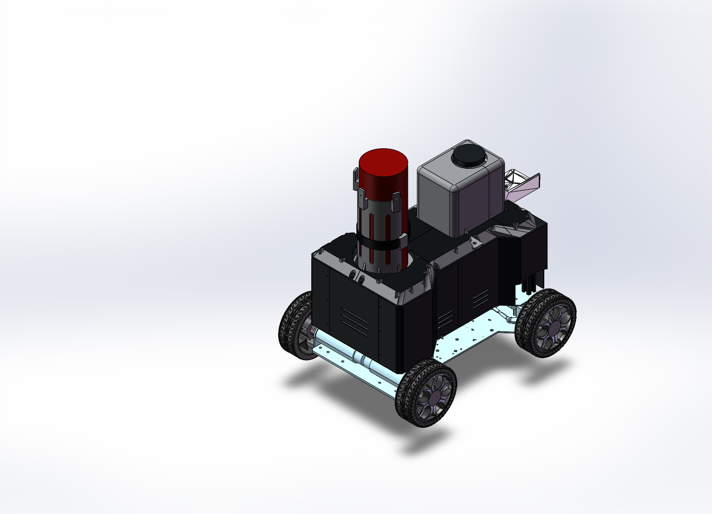

# 3d/ — 整车三维装配

本目录放整机的 **SolidWorks 总装**及其说明，对应规范里"结构图需包含 3D 装配文件"。

## 文件清单

| 文件 | 说明 | 状态 |
|---|---|---|
| `预览-整车装配.png` | 总装渲染预览（1800×1300） | ✅ |
| `装配说明.md` | 作者对 V11 总装的说明（组件数、来源、已知限制） | ✅ |
| `验证记录.txt` | 总装保存/重开的核验记录（72 实例 / 53 零件 / 0 错误） | ✅ |
| `Full_robot_V11.SLDASM` + 53 个 `*.SLDPRT` | SolidWorks 2024 总装与零件（原始 CAD） | ⬜ 体积 124 MB，待单独归档 |
| `Full_robot_V11.STEP` / `.STL` | 通用中间格式（评审/第三方查看用） | ⬜ 待从 SolidWorks 导出 |

> 总装原始包 **124 MB**（SLDASM 62 MB + 53 个零件）。为避免仓库每次 clone 都拉上百 MB，
> 计划以 **GitHub Release 附件** 或单独的 `cad` 分支提供，并在本 README 里给出下载入口；
> 仓库内保留预览图与说明，保证文档可读。

## 装配信息（来自 `装配说明.md` 与 `验证记录.txt`）

| 项 | 值 |
|---|---|
| 总装文件 | `Full_robot_V11.SLDASM` |
| 组件实例 | 72 个 |
| 不同零件文件 | 53 个 |
| 构成 | V10 外壳 24 实例 + 原始底盘 48 实例 |
| 立柱 | 150 mm × 4（100 mm 旧立柱已剔除） |
| 打开方式 | 解压后保持 53 个 SLDPRT 与 SLDASM **同目录**，SolidWorks 2024 SP5 打开 |
| 核验 | 保存/重开无错误无警告，零件引用均在 delivery 内 |

## 已知限制（作者已声明）

1. **静态固定总装**：零件全部固定，不保留原嵌套装配的运动配合 ⇒ **不能直接做转向/悬挂运动仿真**。
2. 车轮转向扫掠、悬挂行程、实际载荷**仍需另行检查**。
3. 灭火器红色圆柱是 **Ø92×230 mm 瓶身占位**，不含阀门与把手。
4. 原始电池零件无法读取，已从保存的 STEP 按名称恢复为 `V11_BREF_023.SLDPRT`。

## 如何导出通用格式（评审/第三方查看）

在 SolidWorks 里打开 `Full_robot_V11.SLDASM`：

1. **文件 → 另存为** → 类型选 **STEP AP214** → 保存为 `Full_robot_V11.step`
   - 选项里勾选"导出装配体为单文件"，单位 mm
2. 再做一次 **另存为** → 类型选 **STL** → 保存为 `Full_robot_V11.stl`
   - 建议：二进制、单位 mm、公差 0.1 mm（整机会比较大，约 30–80 MB）
3. 把两个文件放到本目录，并在 `hardware/README.md` 的清单里勾掉"待补"

> STEP 是评审最稳妥的格式（任何 CAD 都能开）；STL 只适合看外形、不适合量尺寸。

## 结构图（三视图）怎么做

- 在 SolidWorks 里 **新建工程图** → 插入总装的三视图 + 等轴测图 → 另存 PDF；
- 或用 `预览-整车装配.png` 加尺寸标注制作简版三视图；
- 文件名建议 `结构图-整车三视图.pdf`，放本目录。

## 与其它图纸的关系

| 图纸 | 位置 | 内容 |
|---|---|---|
| 扩展板原理图/PCB | [`../原理图-扩展板.pdf`](../原理图-扩展板.pdf)、[`../PCB-扩展板.step`](../PCB-扩展板.step) | 电气 |
| 云台控制板接线图 | [`../接线图-云台控制板.pdf`](../接线图-云台控制板.pdf) | 电气 |
| 整车三维装配 | 本目录 | 结构 |
| 实物照片 | [`../photos/`](../photos/) | 实物 |
